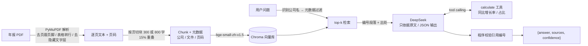

# 年报问答 RAG（Annual Report QA with RAG）

用检索增强生成（RAG）对 A 股上市公司年报做问答：回答只依据年报原文，每个回答附带出处（文件名 + 页码），原文没有的信息回答"年报未披露"，并用 20 道人工标注题量化评估。

语料：宁德时代、比亚迪、工商银行 **2025 年年度报告**（巨潮资讯网，共 908 页）。

## 架构



| 模块 | 文件 | 作用 |
|---|---|---|
| 1 解析 | `src/parse_pdf.py` | PDF → 逐页文本，处理页眉页脚、表格、隐藏文字层 |
| 2 切块 | `src/chunking.py` | 页内按行切块，不跨页，保证页码准确 |
| 2 索引 | `src/index.py` | LlamaIndex + Chroma + bge-small-zh，按公司过滤的 top-k 检索 |
| 3 问答 | `src/qa.py` | DeepSeek 生成 JSON 回答，引用校验，计算工具调用（Agent） |
| 4 评估 | `eval/evaluate.py` | 检索命中率、回答准确率、引用正确率，4 组对比实验 |

## 运行

```bash
# 1. 环境（Python 3.11）
py -3.11 -m venv .venv
.venv/Scripts/pip install torch -r requirements.txt   # 有 NVIDIA 显卡可改装 CUDA 版 torch

# 2. API Key：复制 .env.example 为 .env，填入 DEEPSEEK_API_KEY

# 3. 把年报 PDF 放进 data/raw/，然后依次运行
.venv/Scripts/python -m src.parse_pdf          # 解析
.venv/Scripts/python -m src.chunking           # 查看切块统计
.venv/Scripts/python -m src.index build        # 建向量索引（首次会下载 bge 模型约 100MB）
.venv/Scripts/python -m src.index search "宁德时代2025年营业收入"
.venv/Scripts/python -m src.qa "比亚迪2025年经营活动现金流量净额同比变化多少？"

# 4. 评估（一条命令）
.venv/Scripts/python -m eval.evaluate --retrieval-only   # 只测检索，不调用 API
.venv/Scripts/python -m eval.evaluate                    # 完整评估
```

## 评估

`eval/questions.json`：20 道题 = 15 道数值/文本题 + 3 道计算题（同比变化）+ 2 道"年报未披露"题。每题记录标准答案、判分关键词和**证据关键词**（指标名 + 答案数字）；标准页码（`gold_pages`）= 解析文本中同时包含全部证据关键词的页，由脚本生成，不手工填写（同一数字常在财务摘要、管理层讨论、报表附注中多次出现，这些页都算）。

- **检索命中率**：标准页是否出现在 top-k 结果中（18 道有答案的题）
- **回答准确率**：回答是否包含所有关键要素（规则判分，可复现；未披露题要求回答"未披露"）
- **引用页码正确率**：答对的题中，引用页码包含标准页的比例

<!-- RESULTS -->

## 设计要点

- **减少幻觉**：① prompt 限定只依据原文，没有就答"年报未披露"；② 每段原文带编号和出处，模型只能引用编号；③ JSON 输出；④ 程序校验引用编号真实存在，没有有效出处的回答置信度降为 low；⑤ 计算交给工具，不让模型心算。
- **检索不相关时**：三家公司措辞高度相似，chunk 前加"【公司 第N页】"前缀，并在问题含公司名时按公司过滤；检索结果不含答案时，模型按规则回答"年报未披露"而不是编造。
- **页码准确**：切块不跨页；使用 PDF 物理页码（与阅读器一致，不是年报印刷页码）。

## 已知局限

- 工商银行年报含大量"隐藏文字层"（其他页内容的不可见副本，约 4.1 万字，分布在 159 页），解析时按"文字宽度远小于字数×字号"识别并剔除，否则检索会把答案定位到错误页码。
- 工商银行年报第 194–195 页的可见文字在 PDF 文字层中坐标错乱，无法提取（需 OCR），评估题避开了这两页。
- 跨页的大表格会被切成两页，表头只在第一页。
- 判分采用关键词规则，可能把"写法不同但正确"的回答判错，结果文件 `eval/results/*.json` 可逐题人工复核。
